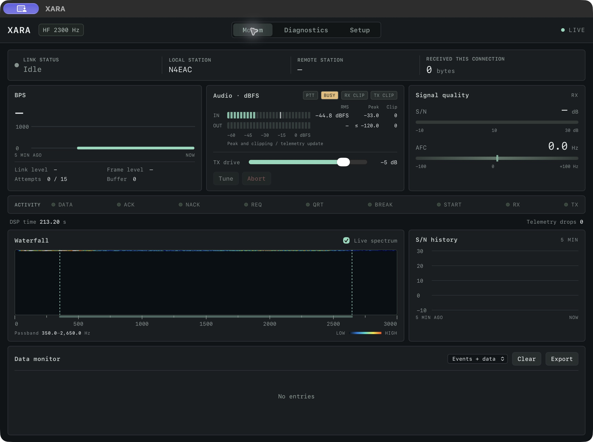
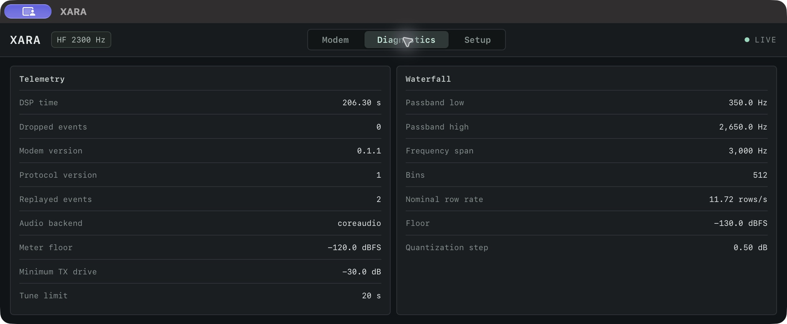

# Xara for macOS

A self-contained macOS application for the XARA VARA-compatible HF/FM modem. The Rust modem engine runs inside the app, with native Core Audio input/output, an instrument panel, and an optional local web interface. No separate modem installation is needed.

Based on **[XARA by x0rro](https://github.com/x0rro/xara)**. The original project provides the modem, DSP, protocol implementation, and host interfaces. This repository provides the macOS application and its integrated interface. It is an independent distribution; the original developer's MIT license and Git history are retained.

[Download the latest release](https://github.com/N4EAC/xara-for-macos/releases/latest) · [Original repository](https://github.com/x0rro/xara) · [Command-line guide](docs/cli.md)



## Compatibility

| Item | Release build |
| --- | --- |
| Processor | Apple Silicon (arm64; M1 or newer) |
| Operating system | macOS 12 Monterey or newer |
| Intel Macs | Not supported by the downloadable ZIP; it is not a Universal build |
| Modem version | XARA 0.1.1; macOS application build 2 |
| Audio | Native Core Audio; 48 kHz, signed 16-bit mono PCM internally |
| Signing | Ad-hoc signed; not Developer ID signed or notarized |

Rust and Xcode are only needed to build from source. The downloadable app contains its modem engine and UI. The minimum OS is the deployment target; operation has not been tested on every macOS release or radio interface. macOS may require approval to open the unnotarized app.

## Setup

1. Download **XARA-macOS-arm64.zip** from [Releases](https://github.com/N4EAC/xara-for-macos/releases/latest), unzip it, and move **XARA.app** to Applications.
2. Open XARA and grant microphone access when prompted. This permission also covers audio received through a USB radio interface.
3. Open **Modem → Station & Radio…** (⌘,) and enter your callsign, select HF bandwidth or FM mode, and choose your radio's audio input and output. The **Setup** tab contains station, audio, and timing settings.
4. Start in receive-only mode. To transmit, explicitly select the radio audio devices and configure serial RTS/DTR, Hamlib rigctld, or VOX PTT. Check audio levels and PTT timing with your radio before an on-air session. CM108 HID PTT is Linux-only.
5. If using external radio software, enable **External software → Enable command/data and KISS ports** in Station & Radio, then connect to `127.0.0.1`: command port **8300**, data port **8301**, or KISS TCP **8100**. These ports are off by default, are unauthenticated for compatibility, and can be changed in Station & Radio if already in use. Enable them only for trusted local radio software.

Save and restart applies engine settings while idle. Settings are stored in `~/Library/Application Support/XARA` and macOS app preferences.

**Modem → Open in Browser** (⌘⇧B) opens the same interface in your default browser. It connects to the app's running modem using an authenticated loopback address; keep the app open. **Modem → Fit to Panels** (⌘0) fits the window to the selected tab.

## Privacy and network access

The macOS app opens one authenticated UI listener on `127.0.0.1` using an automatically assigned port. Its telemetry, received-data previews, waterfall, and controls require the session token. Command/data and KISS listeners are disabled until explicitly enabled in Station & Radio. They remain loopback-only and are unauthenticated for compatibility with radio software. Older saved configurations also default to these ports disabled after this update.

There is no analytics, automatic update checker, cloud service, or automatic Internet request in the app code. The only configurable outbound TCP connection is Hamlib rigctld PTT, used when selected; its default address is `127.0.0.1:4532`. A remote rigctld address connects to the host you explicitly configure.

Saving settings stores callsign, mode, audio-device identifiers, drive/timing, and native PTT/port preferences locally. The app settings directory is owner-only (`0700`) and the settings file is owner-only (`0600`). Window geometry is also saved by macOS. Received payload previews, telemetry history, and audio buffers remain in memory; they are not automatically logged or uploaded. Export writes monitor text only after a user action; the native app shows a save dialog. The separate command-line modem records audio only when explicitly given `--record`.

The embedded web view uses a nonpersistent website data store. An external browser can retain the local URL, session cookie, and display preferences according to its own settings; no payload log is saved in browser storage by the UI. These protections do not isolate XARA from software already running as your macOS user. See [the security review](SECURITY_REVIEW.md) for scope, evidence, and limitations.

## Instruments and interfaces

- BPS history; audio input/output RMS and peak levels in dBFS; clipped-sample counts; AFC and S/N meters.
- DATA, ACK, NACK, REQ, QRT, BREAK, START, RX, and TX indicators; local and connected callsigns; connection state and received-byte total.
- Link/frame levels, retry and buffer information, passband edges, processed audio time, telemetry drops, waterfall, and received-data monitor.
- Setup and Diagnostics tabs, including reported modem/protocol versions, audio backend, meter limits, and waterfall parameters.
- HF bandwidths of 500, 2300, and 2750 Hz; FM narrow and wide modes; local command/data and KISS interfaces.

The received-byte total accumulates decoded payload bytes for each radio connection and resets at the next connection. Clearing the data monitor does not reset that counter. Its text preview shows up to 256 bytes per received payload. Protocol event LEDs remain visible briefly for readability; TX follows PTT. The Live indicator reports the UI telemetry connection, not a radio connection. Unavailable or stale instrument readings are cleared.



## Build from source

Install [Rust](https://www.rust-lang.org/tools/install) (stable) and Xcode Command Line Tools (`xcode-select --install`), then:

```sh
git clone https://github.com/N4EAC/xara-for-macos.git
cd xara-for-macos
./scripts/build_macos_ui.sh
open target/macos/XARA.app
```

The script statically links the Rust engine into an AppKit/WKWebView application, builds for the Mac's current architecture with a macOS 12 deployment target, and signs the bundle locally. The published ZIP is built on Apple Silicon. An Intel source build is not provided or validated by this release.

To package the app:

```sh
ditto -c -k --sequesterRsrc --keepParent \
  target/macos/XARA.app target/macos/XARA-macOS-arm64.zip
```

Use that asset name only for an arm64 build. Higher registered speeds require a source build with the upstream `registered` feature and a registered copy of VARA; the standard app build does not enable it. See the [CLI guide](docs/cli.md) for standalone builds and protocol options.

## Validation

```sh
cargo test --locked --release -p xara-ui -p xara-host
cargo test --locked --release -p xara --no-default-features --features macos-app --lib embedded::tests
cargo test --locked --release -p xara --no-default-features --features macos-app --test telemetry
```

Embedded tests exercise the DSP loop with simulated PCM, authenticated UI access, settings, restart, and shutdown. The browser smoke test is `scripts/test_modem_ui.cjs` and requires Playwright/Chromium with the web directory served on port 8765. Automated tests do not substitute for validation with your radio hardware.

## Credits and license

Original XARA: **[x0rro/xara](https://github.com/x0rro/xara)** by **[x0rro](https://github.com/x0rro)**, based here on commit [`2e96fcd`](https://github.com/x0rro/xara/commit/2e96fcd1563c765a0f5731dae9cc9465c4b86ac6) (0.1.1). Upstream reports compatibility testing against VARA HF 4.9.0 and FM 4.4.0. This macOS distribution is not affiliated with the VARA developer.

Source is available under the [MIT license](LICENSE). Copyright © 2026 x0rro; original notices are preserved.
